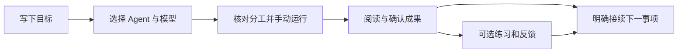

# Life & Learn

面向个人学习与生活的多 Agent 工作台。用户写下一件要做的事，选择参与的 Agent 与模型，主动启动协作，核对成果并完成练习；已确认的成果可以由用户明确接到下一件事项。

> 当前为本地单用户 MVP。求职准备与英语学习是示例路径，并非产品的固定目标；真实学习或求职效果仍需要用户自己评估。

## 体验路径

1. 在**设置 → 模型连接**中连接自己的 DeepSeek、OpenAI、OpenRouter 或兼容接口 API Key，并选择工作区默认模型。
2. 在**工作台 → 新建事项**写下目标；选择求职/英语预设，或自行配置 1–4 个 Agent 步骤。素材可留空，个人事实仍需核对。
3. 保存并核对分工与资料权限，然后点击**开始协作**。模型正文会流式显示；成果按 Markdown 阅读。
4. 核对、纠正并确认成果。在事项的当前题目处输入实际答案，提交后再查看反馈。需要继续时，可明确选择一份已确认成果作为后续事项的来源。

例如可以分别建立“准备 AI 产品经理面试”和“复习雅思词汇”事项，再由用户决定每天的日期、参与时间、回答及跨日来源。



## 本地运行

已在 **macOS、Node.js 22.22.3、npm** 验证。其他操作系统尚未单独验收。

```sh
git clone https://github.com/wjlGitHub2021/LifeAndLearn.git
cd LifeAndLearn
npm ci
npm run dev
```

浏览器打开 **http://127.0.0.1:3000**。在页面内输入自己的模型 API Key；不要把 Key 写入源码、命令行或提交到仓库。结束时在运行终端按 `Ctrl+C`。

生产模式的本地检查：

```sh
npm run build
npm run start
```

`npm run typecheck` 和 `npm test` 分别检查类型与自动化场景。项目不提供测试用的真实模型凭据；调用第三方模型可能产生费用。

## 页面与数据

| 页面 | 用途 |
| --- | --- |
| 工作台 / 我的事项 | 新建、查找和继续事项，优先看到当前需要用户处理的动作。 |
| 日程与数据 | 手动安排日期，查看站内周/月分布与实际运行记录。 |
| Agent 团队 | 创建或调整 Agent 的职责、资料权限和模型选择，查看历史。 |
| 资料与记忆 | 检查事项来源、用户保存的偏好与使用边界。 |
| 设置 | 连接模型、选择默认模型和调整界面。 |

事项、成果、练习与来源保存在本机 SQLite 的 `data/` 中；该目录不进入版本控制。模型 Key 仅保存在后端进程内存，重启后需重新连接。模型请求只在用户发起运行时发送到所选渠道。当前不提供多人账号、外部日历同步、自动联网搜集资料或全天后台运行。

## 更多说明

- [项目定义](docs/PROJECT.md)
- [实际架构](docs/architecture/OVERVIEW.md)
- [本地运行手册](docs/operations/RUNBOOK.md)
- [验证范围](docs/quality/MVP-VERIFICATION.md)
